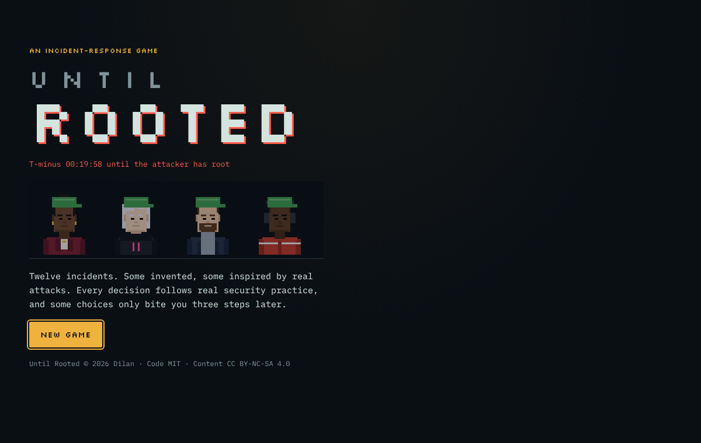
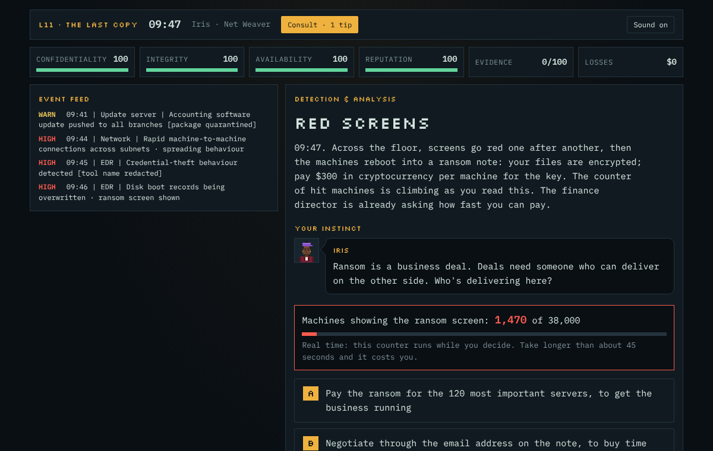

# Until Rooted

**A browser game about defending a company during a cyberattack.**
You are the incident responder. The alarm goes off, the attacker is already inside, and every decision you make has delayed consequences. Twelve levels plus a bonus, from a phished mailbox at a small freight company to a power grid going dark on a winter night.

**▶ Play:** https://DilanSaygili.github.io/UNTIL_ROOTED/



## What the game is about

- **Real defence, no hacking.** Every decision follows real incident-response practice: NIST SP 800-61, MITRE ATT&CK, OWASP, PCI DSS, GDPR's 72-hour rule. The game teaches how to detect, contain and recover. It never shows exploit code or attack tools.
- **The butterfly effect.** A choice that looks safe can come back an hour (or a week) later. The report at the end of each level shows the chain: *this happened because of that.*
- **Inspired by real incidents.** Six levels are inspired by real events (LastPass 2022, Target 2013, Equifax 2017, NotPetya 2017, the Ukrainian power grid 2015, SolarWinds 2020). People and companies in the game are fictional; real names appear only in the *What actually happened…* screen after the level, with sources in `docs/`.
- **Four defenders, four ways to play.** Iris (threat intelligence and ransom negotiation), Echo (malware and forensics), Moritz (security architecture and OT) and Jayson (penetration testing). Each has an ability and a weakness that change the choices you get and what they cost.



## How to play

1. Pick a character, read their ID card, run their background check.
2. Each level starts with a normal working day. Then the alarm.
3. Read the event feed and the meters (Confidentiality, Integrity, Availability, Reputation, Evidence, Losses), then decide. Keys **A–E** pick a choice.
4. Score **70%** or more to earn the level's title and unlock the next level. Score **100%** to earn a tip token for **Consult**: ask a teammate for advice in a later level (from Level 4 on; in Master levels the advice can be wrong).
5. In Master levels one answer is always **None of these**. Choose it when every option is wrong, and two teammates will suggest something better.

| Tier | Levels | Setting | Choices per decision |
|---|---|---|---|
| Beginner (green hat) | 1 Phished at 09:02 · 2 Lights, Camera, Botnet · 3 Patient Zero | home | 2, 3, 4 |
| Intermediate (blue hat) | 4 Injection at Checkout · 5 The Alarm Nobody Answered · 6 Long Weekend | office | 4 |
| Advanced (white hat) | 7 Keys on GitHub · 8 The Last Day · 9 76 Days | New York office | 4 |
| Master (purple hat) | 10 The Helpful Machine · 11 The Last Copy · 12 Lights Out | underground operations centre | 3 + None of these |
| Bonus | The Quiet Guest (unlocked after Level 12) | | 3 + None of these |

Progress is saved in your browser. Add `#demo` to the address for a short training drill that lets you try
Consult and *None of these* at once.

The game works with mouse, touch or keyboard only, on desktop and phone (from 360 px wide), respects
*reduced motion*, and has one mute button for all sound.

## Run it yourself

The game is plain HTML, CSS and JavaScript with no build step and no dependencies.

```
python3 -m http.server 8000
```
Then open http://localhost:8000. Opening `index.html` directly does not work, because the game loads its levels
with `fetch`. (In VS Code, the *Live Server* extension does the same job.)

To make a single HTML file that works without a server:
```
python3 tools/bundle.py until-rooted.html
```

## Writing and checking levels

Each level is one JSON file in `data/levels/`. No code change is needed to add or edit a level.
See `docs/seviye-yazma-rehberi.md` (in Turkish) for every field.

```
node tools/validate.js
```
plays every possible path for all four characters and checks that every ending can be reached, option counts
match the tier, and no bad ending can reach the 70% pass mark. `docs/paths-*.md` lists one path per ending.

## Project structure

- `index.html`, `css/style.css`: page and styles
- `js/engine.js`: the rules (state, conditions, effects, attacker timeline, scoring), with no DOM code
- `js/screens/`: title, character select, level map, level, report
- `js/scene.js`: all pixel art, drawn on canvas (characters, rooms, lighting)
- `js/audio.js`: synthesized sounds; `js/consult.js`: Consult and teammates' suggestions; `js/save.js`: progress
- `data/`: tiers, characters, and one JSON file per level
- `tools/`: level validator and single-file bundler
- `docs/`: one path per ending for each level, and the sources behind every real-event level

## Content safety

All log lines and alerts are fictional and non-functional. Public IP addresses come only from documentation ranges
(192.0.2.0/24, 198.51.100.0/24, 203.0.113.0/24; home devices use private 192.168.x.x addresses), keys are fake (`EXAMPLE-KEY-••••`), and there are no payloads,
scripts, real phishing pages or working attack steps.

## License

- Code (`index.html`, `css/`, `js/`, `tools/`): MIT, see `LICENSE`.
- Content (levels, story, characters, art, the *Until Rooted* name): CC BY-NC-SA 4.0, see `LICENSE-CONTENT`.

© 2026 Dilan
